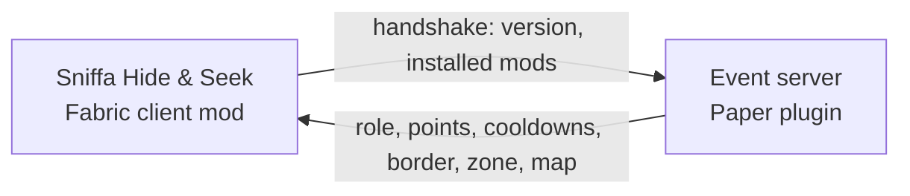

# Sniffa Hide & Seek

The client mod for Marguhl's Hide & Seek event by [Sniffa Studio](https://sniffa.studio). A Fabric mod for
Minecraft 1.21.11. It draws the ability wheel, the radar, the border and the round display. The server half is
a Paper plugin; the event server only lets players in who have this mod.

## Installing

The easy way is one of the modpacks on [sniffa.studio/hs](https://sniffa.studio/hs) (NoRiskClient or Modrinth App).
They contain this mod, Simple Voice Chat and a few performance mods.

By hand:

1. Install the [Fabric Loader](https://fabricmc.net/use/installer/) for Minecraft 1.21.11.
2. Put `marguhl-hideandseek-<version>.jar` from the [releases](https://github.com/sniffa-studio/sniffa-hideandseek/releases)
   into your `mods` folder. Fabric API, Fabric Language Kotlin, GeckoLib and owo-lib are already inside the jar.
3. Start the game and join the event from the title screen.

While the mod is installed the title screen is the event screen. Remove the mod after the event to get the normal
menu back.

## Ist die Mod sicher?

Ja. Der komplette Quellcode liegt hier offen, jeder kann nachlesen, was die Mod macht.

**Was die Mod tut**

- Sie zeigt an, was der Event-Server ihr schickt: Rolle, Punkte, Fähigkeiten, Border, Radar, Karte.
- Beim Betreten des Event-Servers meldet sie dem Server ihre Version und die Liste deiner installierten Mods
  (nur Name und ID). So kann der Server Mods wie Freecam, JourneyMap oder Cheat-Clients abweisen.
- Auf dem Titelbildschirm fragt sie `event.sniffa.studio` ab, ob das Event offen ist. Das ist dieselbe Abfrage, die
  Minecraft für jeden Server in deiner Serverliste macht. Abschalten: `ping_event_server=false` in
  `config/hideandseek.properties`.
- Der Discord-Knopf öffnet `discord.sniffa.studio` im Browser, erst nachdem du es bestätigt hast.
- Hast du Iris, schaltet sie auf dem Event-Server die Shader aus und danach wieder an.
- Sie schreibt genau eine Datei: `config/hideandseek.properties`.

**Was die Mod nicht tut**

- Sie lädt nichts aus dem Internet nach und startet keine Programme.
- Sie liest keine Dateien außer ihrer eigenen Einstellung, keine Passwörter, keine Accounts, keine Tokens.
- Sie tauscht nur mit dem Event-Server Daten aus, und das nur über deine normale Minecraft-Verbindung. Auf anderen
  Servern schickt sie nichts.

**Selbst prüfen**

- Jeder Release hat eine SHA-256-Prüfsumme in den Release-Notizen. Vergleiche sie mit deiner Datei
  (Windows: `certutil -hashfile marguhl-hideandseek-<version>.jar SHA256`).
- Oder bau die Mod selbst aus diesem Code (siehe unten) und nutz deine eigene Jar.
- Manche Virenscanner melden `.jar`-Dateien grundlos. Wenn du unsicher bist, lade die Jar bei
  [VirusTotal](https://www.virustotal.com) hoch.

## How it works

The mod announces itself when it connects. After that the server decides everything and pushes down what changed:
your role, your points, what is cooling down, where the border is. The mod only draws it, so two players never see
two different rounds.



All of it travels as plugin messages on the `hideandseek:` channels inside the normal Minecraft connection.

## Configuration

`config/hideandseek.properties` is written on first start.

| Key | Default | Effect |
|---|---|---|
| `ping_event_server` | `true` | The title screen asks `event.sniffa.studio` whether the event is open. `false` turns that off. |

## Building

Java 21 or newer.

```
./gradlew build
```

The jar is `build/libs/marguhl-hideandseek-<version>.jar`. The version comes from `gradle.properties`.
`./gradlew runClient` starts a development client.

## Releasing

1. Raise `version` in `gradle.properties` and add the release to [CHANGELOG.md](CHANGELOG.md).
2. Build the jar and attach it to a GitHub release together with its SHA-256.

## License

MIT, see [LICENSE](LICENSE). The icon and the Sniffa and Marguhl logos are excluded and may not be reused without
permission.
